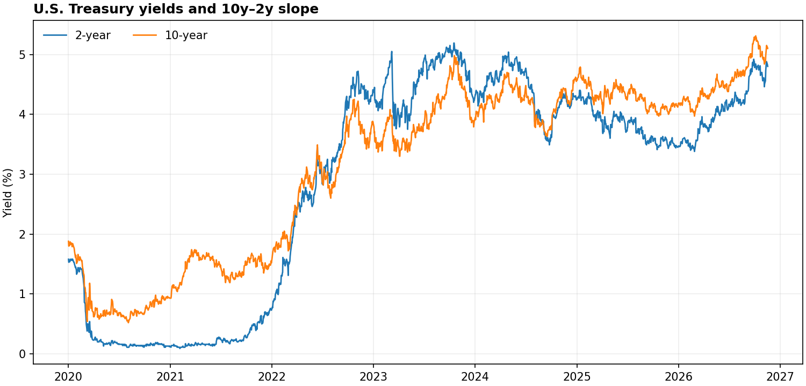

# 01 · Market & Macro Monitor

**Status:** Computed from public source data · **Source:** [U.S. Treasury daily yield curve](https://home.treasury.gov/treasury-daily-interest-rate-xml-feed) · [Open the full study page](../deliverables/01/index.html)

> 1,720 daily observations; the 10y–2y curve was inverted on 31.5% of observed days.

## Method

Completed descriptive analysis of official daily yield observations. Parse Treasury XML and calculate daily constant-maturity curve slopes; report distribution, coverage and inversion share.

## Results

| Measure | Value |
|---|---|
| Source rows | 1,720 |
| First date | 2020-01-02 |
| Last date | 2026-11-17 |
| Median 10y 2y slope (%) points | 0.37 |
| Inverted curve observations | 541 |
| Inverted curve share (%) | 31.45 |
| Max 10y 2y slope (%) points | 1.59 |
| Min 10y 2y slope (%) points | -1.08 |

## Source

https://home.treasury.gov/treasury-daily-interest-rate-xml-feed

## Limitations

- Par yields are indicative curve estimates, not realized bond total returns.
- No macro causal claim or yield forecast is made.

This is a public-data study, not a client engagement. Not investment advice.
