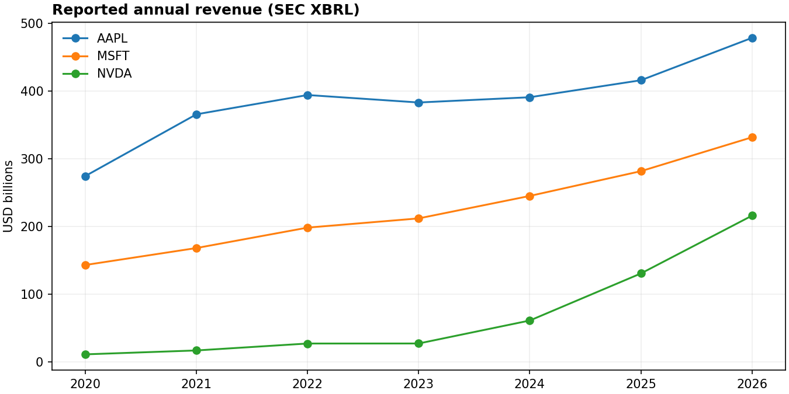

# 02 · Quantitative Company Analysis

**Status:** Computed from public source data · **Source:** [SEC Company Facts / EDGAR](https://www.sec.gov/edgar/sec-api-documentation) · [Open the full study page](../deliverables/02/index.html)

> SEC annual facts for 3 issuers, FY 2020–2026; latest revenues: AAPL $478.8bn, MSFT $331.8bn, NVDA $215.9bn.

## Method

Completed annual-filing comparison using SEC XBRL facts for three large U.S. issuers. For each issuer, select duration facts from annual 10-K filings, retain fiscal year and filed date, then calculate revenue growth, margins and liabilities/assets. The extraction code is visible in scripts/build_studies.py.

## Results

| Measure | Value |
|---|---|
| Issuers | 3 |
| Fiscal years | 2020-2026 |
| Latest revenue (USD) · MSFT | 331.8 bn |
| Latest revenue (USD) · AAPL | 478.8 bn |
| Latest revenue (USD) · NVDA | 215.9 bn |
| Latest filed date · MSFT | 2026-07-29 |
| Latest filed date · AAPL | 2026-11-03 |
| Latest filed date · NVDA | 2026-02-25 |

## Source

https://www.sec.gov/edgar/sec-api-documentation

## Limitations

- XBRL tags can differ across issuers and require analyst review.
- This is descriptive company research; no valuation target or recommendation.
- No share prices or market-cap multiples are included.

This is a public-data study, not a client engagement. Not investment advice.
