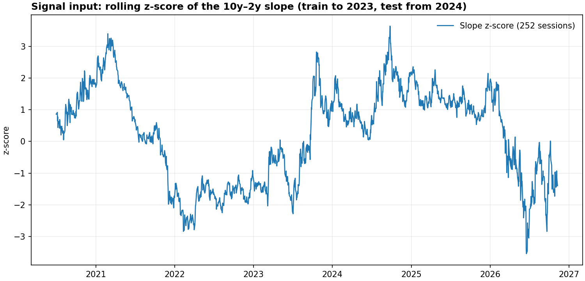

# 03 · Strategy Research & Backtesting

**Status:** Computed from public source data · **Source:** [U.S. Treasury daily yield curve](https://home.treasury.gov/treasury-daily-interest-rate-xml-feed) · [Open the full study page](../deliverables/03/index.html)

> Out-of-sample 5-session curve-change MAE: 5.10 bp vs 5.09 bp baseline; the signal did not improve MAE.

## Method

Completed time-ordered test of a curve-state research signal against a mean baseline. Train a one-variable linear diagnostic on 2020–2023 rolling-standardized 10y–2y slope; evaluate five-session forward slope change on 2024–latest. Compare mean absolute error and direction hit rate to a training-mean baseline.

## Results

| Measure | Value |
|---|---|
| Train observations | 876 |
| Test observations | 714 |
| Train through | 2023-12-29 |
| Test from | 2024-01-02 |
| Out-of-sample MAE (bp) | 5.10 |
| Mean baseline MAE (bp) | 5.09 |
| Out-of-sample direction hit (%) | 50.14 |
| Interpretation | forecast diagnostic only; not a tradable strategy or realized return |

## Source

https://home.treasury.gov/treasury-daily-interest-rate-xml-feed

## Limitations

- The target is a yield-curve change, not instrument P&L.
- No transaction costs, execution, risk-adjusted return or tradability claim.
- No hyperparameter search was performed.

This is a public-data study, not a client engagement. Not investment advice.
