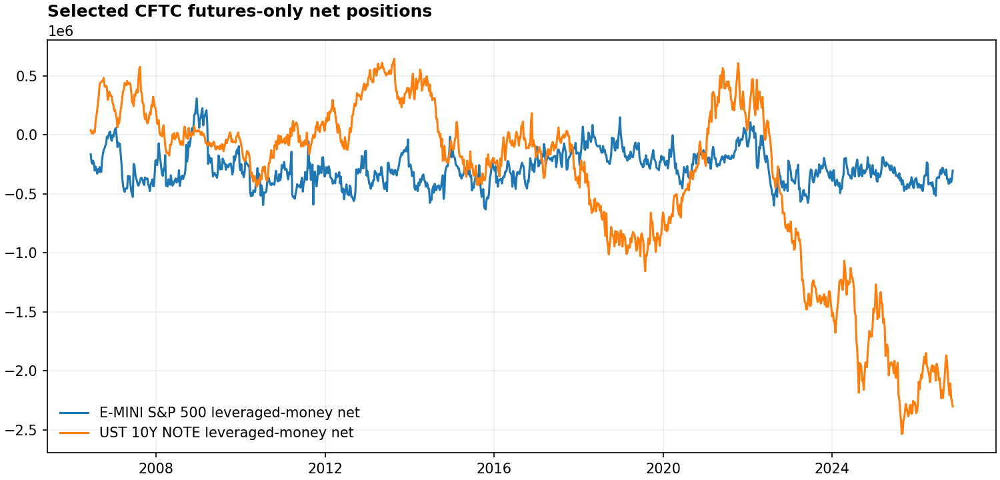

# 05 · Positions, Leverage & Carry

**Status:** Computed from public source data · **Source:** [CFTC Traders in Financial Futures](https://publicreporting.cftc.gov/Commitments-of-Traders/TFF-Futures-Only/gpe5-46if) · [Open the full study page](../deliverables/05/index.html)

> CFTC TFF futures-only records across 6 selected Treasury and S&P futures contracts; latest report 2026-11-10.

## Method

Completed descriptive positioning analysis of CFTC TFF futures-only aggregates. Filter futures-only CFTC TFF series to selected U.S. Treasury and E-mini S&P 500 contracts; compute category net positions as long minus short and report open interest and latest observation.

## Results

| Measure | Value |
|---|---|
| Contracts | 6 |
| Latest report date | 2026-11-10 |
| Series included | E-MINI S&P 500, S&P 500 Consolidated, UST 10Y NOTE, UST 2Y NOTE, UST 5Y NOTE, UST BOND |

## Source

https://publicreporting.cftc.gov/Commitments-of-Traders/TFF-Futures-Only/gpe5-46if

## Limitations

- CFTC categories classify reportable traders; they do not identify individual accounts.
- Open interest and trader net positioning are not portfolio exposures or predictive signals.
- Only public aggregate rows are retained in derived tables.

This is a public-data study, not a client engagement. Not investment advice.
