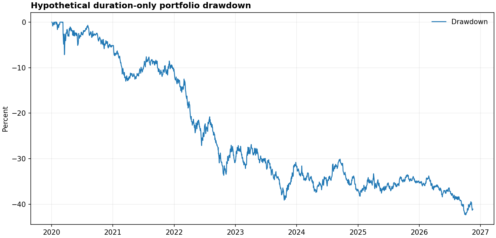

# 06 · Portfolio Risk & What-if Analysis

**Status:** Computed with stated hypothetical inputs · **Source:** [U.S. Treasury daily yield curve](https://home.treasury.gov/treasury-daily-interest-rate-xml-feed) · [Open the full study page](../deliverables/06/index.html)

> Illustrative duration proxy: historical one-day 95% VaR 0.99%; hypothetical +100bp parallel shock -11.0%.

## Method

Completed historical and hypothetical shock analysis for a clearly specified duration-only portfolio. Compute daily bond proxy returns from Treasury yield changes, use an illustrative 20/60/20 split across 5y/10y/20y durations, calculate historical 95% daily VaR/ES and a +100bp parallel duration shock.

## Results

| Measure | Value |
|---|---|
| Portfolio weights · Bond 2y proxy return | 0.00 |
| Portfolio weights · Bond 5y proxy return | 0.20 |
| Portfolio weights · Bond 10y proxy return | 0.60 |
| Portfolio weights · Bond 30y proxy return | 0.20 |
| Observations | 1,719 |
| Daily historical VaR 95 (%) | 0.99 |
| Daily historical ES 95 (%) | 1.37 |
| Historical worst day (%) | -3.07 |
| Hypothetical parallel plus 100bp loss (%) | -11.00 |
| Assumed duration years · Bond 2y proxy return | 2 |
| Assumed duration years · Bond 5y proxy return | 5 |
| Assumed duration years · Bond 10y proxy return | 10 |
| Assumed duration years · Bond 30y proxy return | 20 |

## Source

https://home.treasury.gov/treasury-daily-interest-rate-xml-feed

## Limitations

- Portfolio and duration assumptions are hypothetical.
- Historical VaR/ES from duration proxies omit coupons and convexity and do not estimate client portfolio losses.
- Parallel shock is a first-order sensitivity, not a forecast.

This is a public-data study, not a client engagement. Not investment advice.
