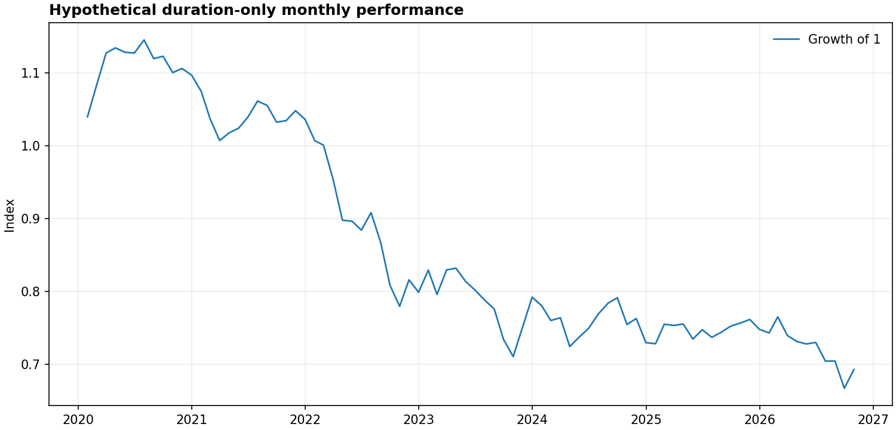

# 08 · Performance & Investor Reporting

**Status:** Computed with stated hypothetical inputs · **Source:** [U.S. Treasury daily yield curve](https://home.treasury.gov/treasury-daily-interest-rate-xml-feed) · [Open the full study page](../deliverables/08/index.html)

> Hypothetical duration-only portfolio: 82 full months; proxy cumulative change -30.7% through 2026-10-31. Not fund performance.

## Method

Completed monthly reporting demonstrator for a hypothetical duration-only portfolio driven by real Treasury yield changes. Compound daily first-order duration proxy returns to monthly figures, calculate cumulative growth and drawdown, and provide a reproducible monthly table.

## Results

| Measure | Value |
|---|---|
| Months | 82 |
| Start month | 2020-01-31 |
| End month | 2026-10-31 |
| Cumulative proxy return (%) | -30.69 |
| Best month (%) | 5.64 |
| Worst month (%) | -6.79 |
| Ending growth of 1 | 0.69 |

## Source

https://home.treasury.gov/treasury-daily-interest-rate-xml-feed

## Limitations

- This is not a real fund, client account or administrator-reconciled NAV series.
- Hypothetical position weights and duration-only return assumptions; no fees or flows.
- The pack illustrates reporting mechanics only.

This is a public-data study, not a client engagement. Not investment advice.
