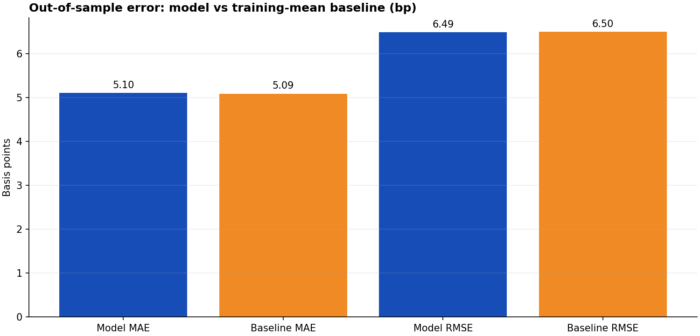

# 09 · Quantitative Model Validation

**Status:** Computed from public source data · **Source:** [U.S. Treasury daily yield curve](https://home.treasury.gov/treasury-daily-interest-rate-xml-feed) · [Open the full study page](../deliverables/09/index.html)

> Out-of-sample MAE 5.10 bp vs baseline 5.09 bp; direction hit rate 50.1%.

## Method

Completed out-of-sample validation of a simple curve-state forecast, including baseline and error metrics. Freeze a linear model trained through 2023-12-31; validate next-five-session 10y–2y slope change on 2024–latest. Compare out-of-sample errors and direction accuracy to the training-mean baseline.

## Results

| Measure | Value |
|---|---|
| Test period | 2024-01-02 to 2026-11-09 |
| Test observations | 714 |
| Model MAE (bp) | 5.10 |
| Baseline MAE (bp) | 5.09 |
| Model RMSE (bp) | 6.49 |
| Baseline RMSE (bp) | 6.50 |
| Model direction hit (%) | 50.14 |
| Baseline direction hit (%) | 48.60 |
| Slope coefficient | 0.58 |
| R squared train | 0.0082 |

## Source

https://home.treasury.gov/treasury-daily-interest-rate-xml-feed

## Limitations

- This is an illustrative single-target model validation, not a validation of a client or production model.
- One chronological split and one baseline; results may be unstable across regimes.
- Forecast target is yield-curve slope change, not return or investment performance.

This is a public-data study, not a client engagement. Not investment advice.
