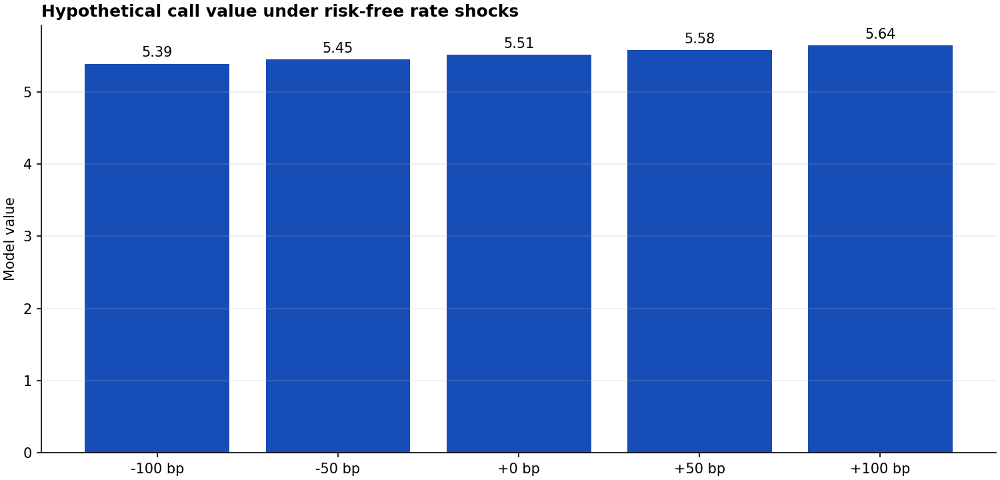

# 10 · Derivatives & Pricing

**Status:** Computed with stated hypothetical inputs · **Source:** [U.S. Treasury daily 3-month par yield](https://home.treasury.gov/treasury-daily-interest-rate-xml-feed) · [Open the full study page](../deliverables/10/index.html)

> Hypothetical European call value 5.51 at observed 3-month Treasury rate 4.33%; other contract inputs are assumed.

## Method

Completed Black–Scholes–Merton scenario using the observed Treasury 3-month par rate and explicitly hypothetical option terms. Use latest available 3-month Treasury par yield as risk-free rate; calculate European call price and Greeks for a hypothetical at-the-money contract. Reprice over ±100bp rate shocks.

## Results

| Measure | Value |
|---|---|
| Data date | 2026-11-17 |
| Treasury 3-month rate (%) | 4.33 |
| Contract | hypothetical European call |
| Spot | 100.00 |
| Strike | 100.00 |
| Tenor years | 0.25 |
| Volatility (%) | 25.00 |
| Dividend yield (%) | 0.00 |
| Model price | 5.51 |
| Delta | 0.56 |
| Gamma | 0.03 |
| Vega per 1vol point | 0.20 |
| Assumptions are hypothetical except rate | Yes |

## Source

https://home.treasury.gov/treasury-daily-interest-rate-xml-feed

## Limitations

- Spot, strike, maturity, volatility and dividend yield are illustrative assumptions, not market quotes.
- European exercise only; no bid/ask, discrete dividends, borrow, funding basis or transaction costs.
- Not an executable valuation or recommendation.

This is a public-data study, not a client engagement. Not investment advice.
