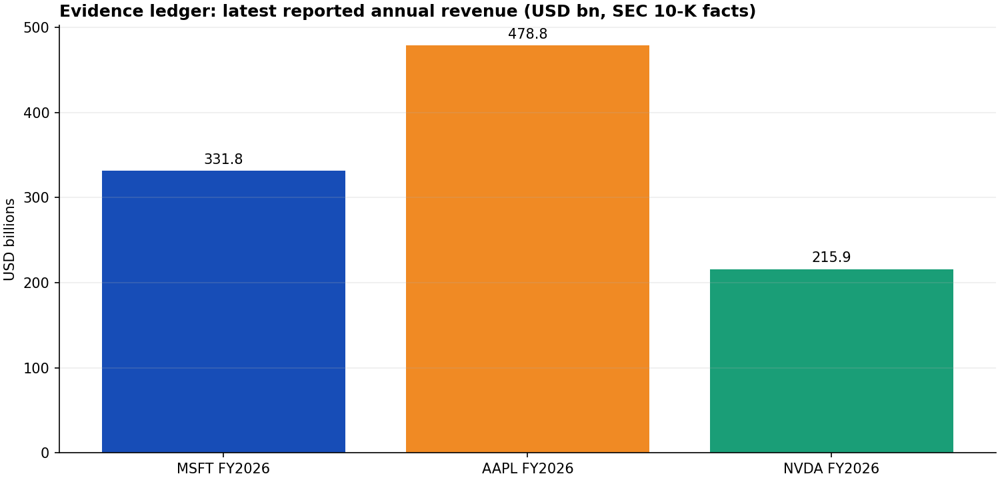

# 12 · AI-assisted Quantitative Research

**Status:** Computed evidence workflow; no LLM · **Source:** [SEC Company Facts / EDGAR](https://www.sec.gov/edgar/sec-api-documentation) · [Open the full study page](../deliverables/12/index.html)

> Evidence ledger contains 3 issuer records; deterministic extraction only, with no external LLM call.

## Method

Completed deterministic, source-linked research demonstrator using official SEC annual facts; no AI-generated claim is presented as verified fact. Generate a concise issuer evidence ledger from extracted annual SEC facts, retaining ticker, fiscal year, filed date and source endpoint. AI is not called; the demonstrator verifies the no-AI manual fallback and citation structure.

## Results

| Measure | Value |
|---|---|
| Evidence rows | 3 |
| Issuer coverage | AAPL, MSFT, NVDA |
| Method | XBRL extraction, filed-date preservation, calculations, evidence ledger; no LLM generation |

## Source

https://www.sec.gov/edgar/sec-api-documentation

## Limitations

- This demonstrates the evidence workflow; it is not independent investment research or advice.
- No external model or AI API was used.
- Statements are limited to the fields and periods explicitly recorded.

This is a public-data study, not a client engagement. Not investment advice.
